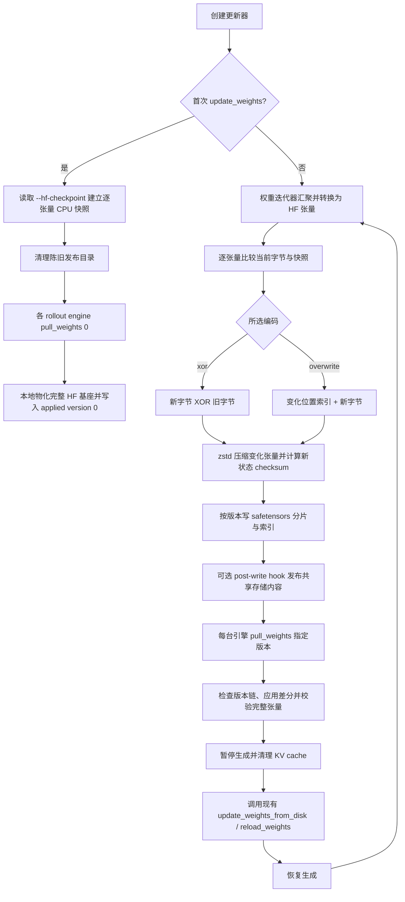
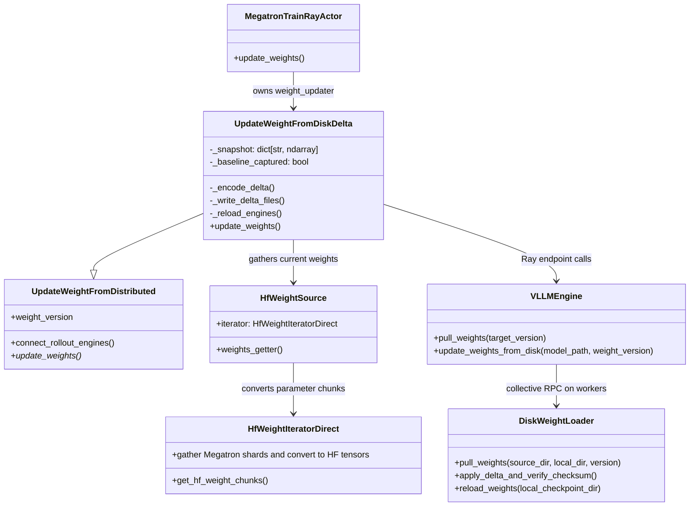

# 共享磁盘上的增量权重同步

## 背景与适用范围

RL 训练每次更新模型后，都要把新权重交给 vLLM rollout 引擎。完整同步会重复保存、传送并重新读取整个 Hugging Face checkpoint；模型越大，重复处理的无变化权重越多。VIME 的 disk delta 路径复用共享文件系统：初次同步让每台推理主机建立完整本地基座，后续发布相对于前一版本的张量字节差分，由引擎端将差分应用到本地 safetensors，再调用原有磁盘 reload 接口。训练端与推理端无须建立 tensor collective 通信组。

这里的 delta 以 HF 转换后的张量**字节**为单位，不是参数级浮点减法。当前 Ascend 分支的该路径实现了 `xor` 和 `overwrite` 两种编码，以及 zstd 压缩、Adler-32 新状态校验。

## 总体流程图



首次调用只捕获基线并触发 `pull_weights(0)`，不训练或发布增量。后续每轮的差分索引带 `version` 和 `base_version`，要求本地版本与增量的基版本一致；版本不连续会报错。引擎在应用后计算新状态 checksum，只有全部权重成功验证才提交本地状态版本。

## 接口时序图

```mermaid
sequenceDiagram
    autonumber
    participant Train as Megatron trainer ranks
    participant Updater as UpdateWeightFromDiskDelta
    participant FS as Shared filesystem
    participant Engine as vLLM engine endpoint
    participant Workers as Engine workers on each host
    participant Loader as Ascend/vLLM disk reload

    Train->>Updater: update_weights() first call
    Updater->>FS: read HF base / clear stale delta stream
    Updater->>Engine: pull_weights(0)
    Engine->>Workers: collective_rpc(pull_weights)
    Workers->>FS: copy full base checkpoint locally
    Workers->>Workers: commit local applied version 0
    Updater-->>Train: baseline snapshot ready

    loop Each trained version
        Train->>Updater: update_weights()
        Updater->>Train: gather and convert parameters to HF tensor chunks
        Updater->>Updater: byte diff, encode, zstd, checksum
        Updater->>FS: write versioned safetensors shards and index
        opt shared object store requires explicit publish
            Updater->>FS: invoke configured post-write hook
        end
        Updater->>Engine: pull_weights(version)
        Engine->>Workers: collective_rpc(pull_weights)
        Workers->>FS: read versions after local applied version
        Workers->>Workers: verify base_version, apply delta, verify checksums
        Updater->>Engine: pause_generation(); flush_cache()
        Updater->>Engine: update_weights_from_disk(local_path, version)
        Engine->>Loader: reload_weights(checkpoint format)
        Loader-->>Engine: weights loaded
        Updater->>Engine: continue_generation()
        Updater-->>Train: update complete; advance snapshot
    end
```

**接口路径：**训练 actor 的 `update_weights()` 调用更新器；`UpdateWeightFromDiskDelta` 的 `_publish()` 编码并落盘；`_reload_engines()` 通过 Ray 调用 `VLLMEngine.pull_weights()`，随后调用 `update_weights_from_disk()`。后者走 vLLM `/collective_rpc` 的 `pull_weights` 与 `reload_weights` 方法，由 worker 应用本地文件并重载模型。对象存储或缓存文件系统如缺少跨主机读后写一致性，可用配置的 post-write hook 在 pull 前提交文件。

## 类与责任



**类图注释：**图中 `DiskWeightLoader` 表示 `docker/npu_patch/vllm.patch` 为 vLLM 增加的加载端实现；它不是 Python 运行时里与 VIME 更新器同目录的类。源代码的精确模块归属以实际补丁应用到 vLLM 源码后的文件为准。

## 编码与提交规则

对每个经 HF iterator 输出的张量，训练端先把连续张量视为 uint8 字节序列，并和上一版本快照比较。若没有字节变化，该张量不进入本版本的增量索引；比较后仍要刷新快照，以便下一轮相对于最近一次发布。

| 编码 | 保存内容 | 应用规则 | 说明 |
| --- | --- | --- | --- |
| `xor` | 逐字节 `new XOR old`，再 zstd 压缩 | `old XOR delta` 得到新状态 | 应用相同版本两次会回到旧状态；依靠版本状态避免重放 |
| `overwrite` | 变化字节数量、uint32 位置数组、新字节，再 zstd 压缩 | 在列出的位置写入新字节 | 对相同版本重复写入是幂等的 |

表注：`uint32` 位置相对于单个展平张量的字节偏移；checksum 针对应用后的完整张量字节，而不是压缩文件或差分载荷。

一个版本先由各训练 rank 写自己的增量 safetensors 分片，gloo 汇总文件计数和 tensor 到文件的映射，rank 0 写 `model.safetensors.index.json`。分片及索引带版本号和基版本号；原子替换降低读取到半写文件的风险。引擎端用文件锁串行化本地主机更新：从已应用版本逐版应用，校验解压长度、顺序和 checksum 后，再原子提交 `.weight_sync/state.json`。收到已经应用的版本会直接跳过，缺文件、基版本不匹配或校验失败则中止更新，不推进状态版本。

| 属性 | 意义 |
| --- | --- |
| `metadata.version` | 这份增量表示的目标权重版本 |
| `metadata.base_version` | 应用前要求的本地权重版本 |
| `metadata.delta_encoding` | 本版本差分编码：`xor` 或 `overwrite` |
| `metadata.compression_format` | 差分张量载荷的压缩格式：`zstd` |
| `metadata.checksum_format` | 应用后校验完整张量时使用的算法 |
| `weight_map` | HF 张量名到版本内 safetensors 分片文件的映射 |
| `.weight_sync/state.json` | 引擎本地已完整校验并应用的最高版本 |

表注：这些字段描述发布端索引或引擎本地提交状态。每轮更新字节、总字节、载荷字节和更新耗时记录在 E2E 结果文件中；`update_seconds` 由 actor 调用边界计时，涵盖差分发布和 rollout 引擎 reload。

## 30B E2E 精度验证

`tests/test_delta_disk_weight_update.py` 取代旧的 Qwen3-0.6B 文件级 smoke test，继续在同一测试里覆盖 XOR、overwrite。每种编码以 Qwen3-30B-A3B 执行基线初始化和两个真实训练 / 更新轮次，训练使用仓库现有 30B Megatron 并行配置：8 个训练 NPU、TP=4、PP=1、EP=8；单个 rollout 引擎使用 2 个 NPU。测试同时检查两个非空版本、索引链、本地状态版本以及所有最终重建权重的原始字节都与独立 HF checkpoint 一致。完整 checkpoint 通过训练模型的普通 HF 保存迭代器重新转换导出，不读取 delta 文件或本地 delta 快照。

推理侧保存一组固定 prompt token IDs 和 greedy sampling 参数，在增量更新后的 rollout engine 上生成一次并重跑以检查可重复性；之后关闭原服务，在相同 2 个 rollout NPU、拓扑和服务参数下启动新服务，从独立导出的 HF checkpoint 直接加载。两路生成必须有相同 token IDs、逐 token logprob 和 finish reason，缺失/非有限 logprob 也失败。比较文件报告是否完全匹配及最大绝对 logprob 差值；当前通过判定要求差值为精确零。

这个比较为给定 checkpoint、软件栈、并行布局及单条提示提供严格的权重加载 / 同步一致性证据。它不能证明所有输入上的数学精度，也不能单独区分训练更新错误、HF 转换差异或推理内核数值差异；因此训练和独立 full export 使用同一 HF 格式及同一 engine 配置，比较中保存 prompt IDs 和完整采样参数以便复核。

结果目录默认为 `$HF_HOME/disk-delta-30b-<unique-id>`，也可用 `DISK_DELTA_RESULT_DIR` 指定。每种编码会保存 `baseline.json`、`round-metrics.json`、`delta-inference.json`、`checkpoint-inference.json`、`comparison.json` 和 `validation.json`。本地基座、差分分片和独立完整 checkpoint 在逐字节及推理对照结束后清理，保留紧凑 JSON 证据，避免每种编码留下多个数十 GB 的权重副本。指标解释如下：

| 字段 | 含义 / 单位 |
| --- | --- |
| `changed_bytes` | 当前版本变化的张量字节数，字节；用于确认发布了非空更新 |
| `total_bytes` | 当前版本参与 diff 的 HF 权重字节数，字节 |
| `wire_bytes` | 序列化 safetensors 增量分片大小，字节；不含共享文件系统元数据 |
| `update_seconds` | trainer actor 的一次 disk delta 更新调用耗时，秒；包括发布和 rollout reload |
| `checked_delta_tensors` | 最终版本索引中的 tensor checksum 验证数量，个 |
| `checked_full_checkpoint_tensors` | delta 重建与独立完整 checkpoint 逐张量字节比较数量，个 |
| `max_abs_logprob_error` | 两服务生成 token logprob 的最大绝对差；成功要求精确为 `0.0` |

表注：上述计数是 E2E 功能验证实际写出的字段；当前 A5 实机结果尚未完成，实测耗时、压缩率和精度数据待测试完成后同步。每个 `update_seconds` 单位为秒且仅覆盖同一进程内更新调用边界，不是端到端训练时长。

## 代码入口

- 训练端差分、版本发布和引擎同步：`vime/backends/megatron_utils/update_weight/update_weight_from_disk_delta.py`
- Full/disk updater 基类及普通磁盘保存行为：`vime/backends/megatron_utils/update_weight/update_weight_from_disk.py`
- HF 张量到 safetensors 文件的保存和独立完整 checkpoint 转换：`vime/backends/megatron_utils/hf_checkpoint_saver.py`
- XOR / overwrite 字节辅助函数及 safetensors tensor reader：`vime/utils/disk_delta.py`
- 引擎 Ray endpoint 与 `pull_weights` / reload 请求：`vime/backends/vllm_utils/vllm_engine.py`
- disk delta 参数及共享目录约定：`vime/utils/arguments.py`
- 引擎端版本链、差分应用和 checksum 逻辑：应用 `docker/npu_patch/vllm.patch` 到相应 vLLM checkout 后的实现
- 30B E2E 测试入口：`tests/test_delta_disk_weight_update.py`，NPU 测试套件：`.buildkite/npu_suites.py`
